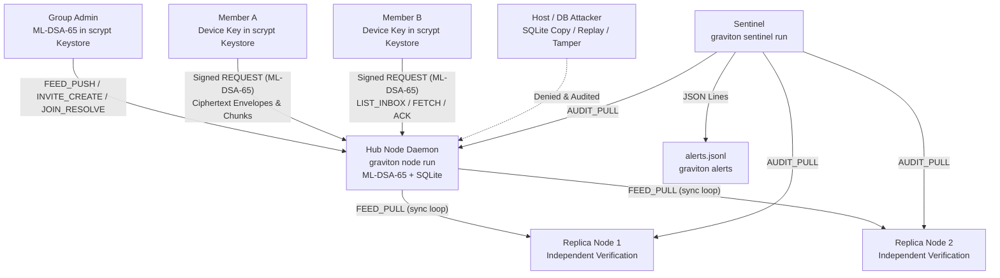
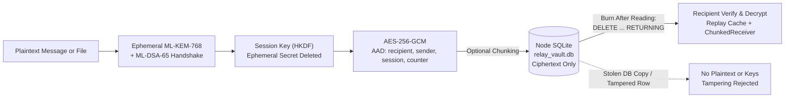

# Graviton

Post-quantum zero-trust group policy, tamper-evident audit logging, and end-to-end encrypted messaging over untrusted storage (`ML-DSA-65` + `ML-KEM-768` + `AES-256-GCM`).

UX inspired by the author's earlier project Pandora's Veil; no code reused. Practice detection fixtures are attributed in [fixtures/ATTRIBUTION.md](fixtures/ATTRIBUTION.md) to `ScalerOpenSourceLabs/Track-4-Toolkit` v1.0.0.

## System Architecture





## Clean-Machine Setup (Linux, Python 3.12)

### Core & Track 4 Adapter (`pqcrypto==0.4.0` only)

```bash
python3 -m venv .venv
.venv/bin/python -m pip install -r requirements.txt
.venv/bin/python -m pip install --no-deps .
.venv/bin/python -m unittest discover -s tests -v
```

### Full Engine (`pqcrypto==0.4.0` + `cryptography==50.0.2`)

```bash
python3 -m venv .venv-app
.venv-app/bin/python -m pip install -r requirements.txt cryptography==50.0.2
.venv-app/bin/python -m pip install --no-deps .
.venv-app/bin/graviton doctor
```

## Exact Verification Commands

- **Unit & Engine Tests**: `python -m unittest discover -s tests -v`
- **Official Track 4 Toolkit Validator** (with `Track-4-Toolkit` cloned as a sibling directory):
  `python ../Track-4-Toolkit/validate.py --entry track4_service.py`
- **Real 3-Node End-to-End Demo**: `python -m graviton.demo` (writes `build/evidence/demo_evidence.json`)
- **Detection Evaluation (Synthetic + Practice + 10-Seed Held-Out)**:
  `python -m graviton detect-eval --out build/detect-metrics.json`
- **Performance Benchmarks**: `python bench/benchmark.py` (writes `build/bench.json`)
- **Red-Team Scenarios (loopback only)**: `graviton redteam all --target 127.0.0.1:<PORT>`
- **2-Page Brief PDF**: `TRACK4_VIDEO_URL=<url> python docs/brief/generate_brief.py` (reads `build/*.json`)

Measured outputs are generated into `build/probe.json`, `build/detect-metrics.json`, `build/bench.json`, and `build/evidence/demo_evidence.json` (summarized in `build/FINAL_REPORT.md`) rather than hard-coded in documentation.

## Documentation

- [docs/COMPLIANCE_MATRIX.md](docs/COMPLIANCE_MATRIX.md) — 12 Track 4 objectives mapped to code, tests, commands, and limits
- [docs/EVIDENCE_SHEET.md](docs/EVIDENCE_SHEET.md) — Evidence artifact inventory
- [docs/THREAT_MODEL.md](docs/THREAT_MODEL.md) — One-page threat model (assets, attackers, assumptions, limits)
- [docs/ASSUMPTIONS.md](docs/ASSUMPTIONS.md) — Trust and environmental assumptions
- [docs/ENGINE_DESIGN.md](docs/ENGINE_DESIGN.md) — Wire protocol, SQLite schemas, limits, and crash recovery
- [docs/DATA_MAP.md](docs/DATA_MAP.md) — Created files, key inventory, and attacker impact
- [demo/RECORDING_CHECKLIST.md](demo/RECORDING_CHECKLIST.md) — 5-minute demo script

## What Is Real / What Is Not

- **Real**: Post-quantum `ML-KEM-768` and `ML-DSA-65` via `pqcrypto==0.4.0`; `AES-256-GCM` and `scrypt` via `cryptography==50.0.2`; key separation (`TRACK4_KEY_DIR` vs `TRACK4_STATE_DIR`), HMAC-authenticated state, anti-rollback `.head.json`, hash-chained + MAC'd adapter audit log, single-use `request_id`, bounded exclusive file locks; multi-process TCP node daemons; deterministic rule/graph/clock-skew Sentinel (zero AI/ML).
- **Not Protected / Limits**: Plaintext TCP by default (optional classical `--tls-cert`/`--tls-key`); metadata (handles, timestamps, sizes) is visible to network and nodes; single-hub `relay`/`vault` data plane in v1; admin `ML-DSA-65` key and admin machine are trusted single points of failure; Track 4 adapter `adapter_state.json` stores contents in plaintext (integrity-protected by HMAC, not encrypted) and a host-root attacker with both state and key dirs can forge MACs; local loopback multi-process clusters only (multi-machine not tested); Python code is not guaranteed constant-time; research prototype not independently audited.
