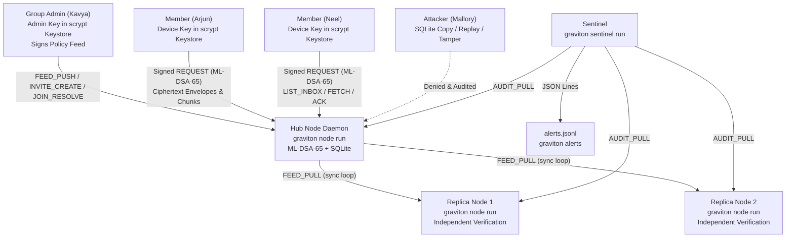
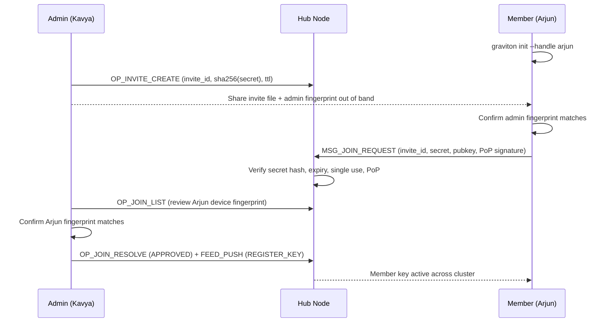
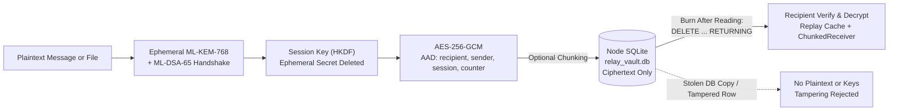
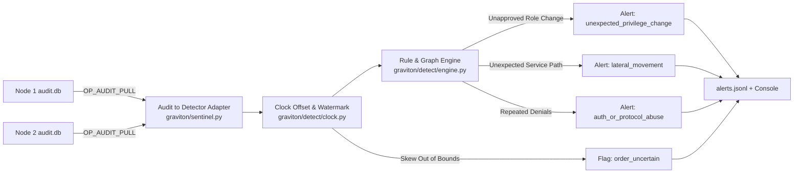

# Graviton

Graviton is a post quantum security engine for zero trust groups, tamper evident audit logging, and end to end encrypted messaging over untrusted storage.

UX inspired by the author's earlier project Pandora's Veil; no code reused.

## What This Project Does

Graviton separates **identity and policy** from **message storage**:

1. **Group Policy and Revocation**: A group administrator (such as Kavya) creates a signed, hash chained policy feed using `ML-DSA-65` (`pqcrypto==0.4.0`). Every enforcement node verifies and applies this feed locally. When a member or device is revoked or rotated, every node independently stops accepting that key.
2. **Untrusted Storage Protection**: Nodes store only opaque encrypted envelopes and encrypted file chunks inside SQLite (`relay_vault.db`). Plaintext messages, private keys, and session keys never touch the node database.
3. **End to End Encrypted Messaging**: Members (such as Arjun and Neel) verify each other's public keys from the signed policy feed, run an ephemeral `ML-KEM-768` handshake signed with `ML-DSA-65` for forward secrecy, and encrypt messages and chunked files with `AES-256-GCM` bound to sender, recipient, session, and counter.
4. **Tamper Evident Audit and Live Detection**: Every allow or deny decision on a node appends a hash chained record to SQLite (`audit.db`) with append only triggers and signed checkpoints. A live Sentinel pulls audit logs across nodes, adjusts for clock skew, flags uncertain ordering, and detects privilege escalation, lateral movement, and protocol abuse without using AI or machine learning.

## System Architecture



## Membership and Invite Sequence

Every member joins through a single use expiring invite plus out of band fingerprint confirmation on both the member side and the admin side.



## End to End Messaging and Database Protection Flow



## Sentinel Audit and Detection Pipeline



## Key Components in the Repository

| Path | Purpose |
| --- | --- |
| [graviton/crypto/](file:///e:/My Projects/Graviton/graviton/crypto/__init__.py) | `ML-KEM-768` encapsulation, `ML-DSA-65` signatures, `HKDF-SHA256`, `AES-256-GCM`, and `scrypt` keystores |
| [graviton/feed/](file:///e:/My Projects/Graviton/graviton/feed/__init__.py) | Canonical binary encoding, signed hash chained policy feed entries, and verification |
| [graviton/nodes/](file:///e:/My Projects/Graviton/graviton/nodes/__init__.py) | Crash safe `Node` state machine enforcing registration, rotation cutoffs, and revocation |
| [graviton/net/](file:///e:/My Projects/Graviton/graviton/net/protocol.py) | Length prefixed binary TCP wire protocol, nonces, sequences, and `NodeClient` |
| [graviton/daemon/node.py](file:///e:/My Projects/Graviton/graviton/daemon/node.py) | `NodeDaemon` TCP server, rate limiting, upstream sync, and SQLite relay and vault store |
| [graviton/admin.py](file:///e:/My Projects/Graviton/graviton/admin.py) | Group initialization, node registration, invites, approvals, revocations, and rotations |
| [graviton/client.py](file:///e:/My Projects/Graviton/graviton/client.py) | Member keystore, verified directory lookup, E2EE handshakes, encrypted local stores, and file transfer |
| [graviton/comms/](file:///e:/My Projects/Graviton/graviton/comms/__init__.py) | Forward secret sessions, `ReplayCache`, `ChunkedReceiver`, and `ResumptionManager` |
| [graviton/audit/log.py](file:///e:/My Projects/Graviton/graviton/audit/log.py) | Hash chained SQLite audit log with append only triggers and signed checkpoints |
| [graviton/detect/](file:///e:/My Projects/Graviton/graviton/detect/__init__.py) | Deterministic rule, graph, and clock skew detector with `detect-eval` |
| [graviton/sentinel.py](file:///e:/My Projects/Graviton/graviton/sentinel.py) | Live multi node audit pull, detector integration, `alerts.jsonl`, and `audit verify` |
| [graviton/redteam.py](file:///e:/My Projects/Graviton/graviton/redteam.py) | Loopback guarded red team verification against live node daemons |
| [graviton/cluster.py](file:///e:/My Projects/Graviton/graviton/cluster.py) | Local multi process cluster manager (`cluster up`, `status`, `down`) |
| [graviton/probe.py](file:///e:/My Projects/Graviton/graviton/probe.py) | External multi run revocation propagation latency measurement |
| [track4_service.py](file:///e:/My Projects/Graviton/track4_service.py) | Track 4 competition adapter for `Track-4-Toolkit/validate.py` |
| [docs/ENGINE_DESIGN.md](file:///e:/My Projects/Graviton/docs/ENGINE_DESIGN.md) | Wire protocol byte layouts, SQLite schemas, limits, and crash recovery design |
| [docs/DATA_MAP.md](file:///e:/My Projects/Graviton/docs/DATA_MAP.md) | Inventory of created files, keys, and attacker impact analysis |

## Installation and Environments

Core verification and the Track 4 adapter require only Python 3.12 and `pqcrypto==0.4.0`. The full client, admin keystore, and E2EE messaging commands add `cryptography==50.0.2` and fail closed if it is not installed.

### Windows (PowerShell)

```powershell
python -m venv .venv
.venv\Scripts\python.exe -m pip install -r requirements.txt

# Optional full environment with AES-256-GCM and scrypt keystores
python -m venv .venv-app
.venv-app\Scripts\python.exe -m pip install -r requirements.txt cryptography==50.0.2
```

### Linux

```bash
python3 -m venv .venv
.venv/bin/python -m pip install -r requirements.txt

# Optional full environment with AES-256-GCM and scrypt keystores
python3 -m venv .venv-app
.venv-app/bin/python -m pip install -r requirements.txt cryptography==50.0.2
```

## CLI Quick Reference

Run commands via `python -m graviton <command>`:

| Command | Role | Description |
| --- | --- | --- |
| `admin init --group NAME` | Admin | Create a new group, admin `scrypt` keystore, and genesis entry |
| `admin add-node HOST:PORT` | Admin | Register a node and push the signed policy feed |
| `admin invite HANDLE [--ttl 15m]` | Admin | Issue a single use expiring invite file |
| `admin pending \| approve HANDLE \| reject HANDLE` | Admin | Review device fingerprints and resolve join requests |
| `admin revoke HANDLE [--device ID]` | Admin | Revoke a member or single device and push to all nodes |
| `admin rotate HANDLE --device ID ...` | Admin | Rotate a device key with a cutoff epoch |
| `node init \| run \| status` | Node | Initialize and run a TCP enforcement node daemon |
| `cluster up --nodes N --dir DIR` | Ops | Start N local node processes with upstream replication |
| `probe revocation --cluster-dir DIR --runs 30` | Ops | Externally measure revocation propagation latency |
| `init --handle NAME` | Member | Create member identity and device `scrypt` keystore |
| `identity` | Member | Show handle, device ID, key version, and fingerprint |
| `join INVITE_FILE` | Member | Submit signed join request after confirming admin fingerprint |
| `send TARGET [TEXT \| --file PATH] [--ttl 1h] [--burn]` | Member | Send E2EE message or chunked file |
| `inbox \| read ID \| chat HANDLE \| shell` | Member | Read inbox, decrypt messages, interactive chat, or `cmd` shell |
| `sentinel run \| alerts [--follow]` | Ops | Pull node audit logs, run live detection, and inspect alerts |
| `audit verify` | Ops | Verify node audit hash chains and external head hashes |
| `redteam SCENARIO --target HOST:PORT` | Test | Run loopback guarded attack checks against a live node |
| `detect-eval \| bench` | Eval | Run synthetic detection evaluation and benchmark suite |

## Verification and Measured Numbers

All tests and validation checks run against real subprocesses, real sockets, and real SQLite files:

1. **Core Suite (`pqcrypto==0.4.0` only)**:
   ```bash
   python -m unittest discover -s tests -v
   ```
   Verified 82 tests (6 skipped where `cryptography` or POSIX mode bits are required), 0 failures.
2. **Track 4 Validator**:
   ```bash
   python ../Track-4-Toolkit/validate.py --entry "../Graviton/track4_service.py"
   ```
   Result: `Local scenario passed.`
3. **Full Engine Suite (`pqcrypto==0.4.0` + `cryptography==50.0.2`)**:
   - `tests/engine/test_stage1_node_daemon.py`: wire framing, signature checks, hostile frames, `kill -9` recovery.
   - `tests/engine/test_stage2_cluster_probe.py`: 3 node cluster, rotation cutoff, offline node catchup, 30 run external revocation probe (`sync_interval=0.1s`, `poll_interval=0.05s`, measured `last_node median=3195.0ms`, `p95=9235.0ms`, `max=9281.0ms`).
   - `tests/engine/test_stage3_membership.py`: invite, out of band fingerprint confirmation, lost device replacement, Mallory isolation, expired/wrong/forged rejections.
   - `tests/engine/test_stage4_data_plane.py`: E2EE messaging, chunked files, burn after reading (`DELETE ... RETURNING`), TTL purge, quotas, raw SQLite byte scan confirming no plaintext or keys, row tamper and reorder detection, cross user isolation, revoked denial on all nodes, and SQL injection inertness.
   - `tests/engine/test_stage5_sentinel_redteam.py`: benign admin workflow (0 alerts), all 9 live red team scenarios denied and alerted, `audit verify`, and `order_uncertain` clock skew handling.
4. **Detection Evaluation Split (`detect-eval`)**:
   Rules and thresholds in `graviton/detect/engine.py` were designed against the specification scenarios and evaluated on separately generated synthetic labelled logs in `graviton/detect/eval.py` (`generate_labelled_dataset`).

## What Is Real and What Is Not (Scope and Limitations)

To be completely transparent about the current engineering boundaries:

- **No transport encryption by default**: Wire traffic uses plaintext TCP unless optional classical TLS (`--tls-cert` and `--tls-key`) is configured. Message payloads are E2EE, but protocol headers are not.
- **Metadata is visible**: Sender, recipient handles, timestamps, and envelope sizes are visible to the network and stored in node SQLite columns for routing and quotas.
- **Single hub data plane in v1**: Policy feeds replicate across all nodes, while `relay` envelopes and `vault` chunks live on the target node only.
- **Admin key and admin machine trust**: The group admin `ML-DSA-65` key is a single point of failure, and the admin machine is assumed trusted.
- **Shared trust domain on adapter path**: On the Track 4 adapter path (`track4_service.py`), the admin key and node state live in the same host directory.
- **Unsynchronised clocks**: Nodes do not run a distributed clock protocol; Sentinel detects skew beyond `5000ms` and marks event ordering as `order_uncertain`.
- **Local multi process only**: Multi machine deployment across separate physical hosts was not tested; all cluster tests run on local loopback sockets.
- **Research prototype**: Graviton has not undergone an independent third party security audit.
