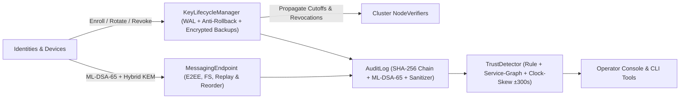

# Graviton — Track 4: "Trust, but verify" (2-Page Project Brief)

**5-Minute Demo Video:** `<INSERT_UNLISTED_YOUTUBE_OR_GDRIVE_LINK_HERE>`  
**Repository:** `<INSERT_PUBLIC_GITHUB_REPO_URL_HERE>`

---

## Page 1 — USP & System Architecture

### Unique Selling Proposition (USP)
**Graviton** unifies NIST-standardized post-quantum cryptography (**ML-KEM-768 + X25519 Hybrid KEM**, **ML-DSA-65** signatures, **AES-256-GCM**), crash-safe atomic key lifecycle management, an injection-proof hash-chained audit log, and an explainable graph + clock-skew-aware lateral-movement detector into a single, zero-boilerplate Python 3.12 prototype.

### Architecture Overview

### Core Components
1. **Post-Quantum & Hybrid Crypto (`graviton/crypto.py`):** Fails closed without `pqcrypto==0.4.0` and `cryptography`. Uses `ML-KEM-768 + X25519` combined via `HKDF-SHA256`, `ML-DSA-65` for authentication, and `AES-256-GCM` for AEAD.
2. **Forward-Secret Messaging (`graviton/messaging.py`):** Ephemeral Hybrid KEM keypairs generated per session and immediately erased upon `finalize_session()`. Enforces replay protection, sender/recipient AAD binding, out-of-order buffering with incomplete-delivery reporting, and ML-DSA-65-bound session resumption.
3. **Key Lifecycle & Recovery (`graviton/lifecycle.py`):** Configurable grace-period cutoff on rotation, multi-node revocation propagation with measured latency, device-loss re-enrollment, SHA-256-checksummed WAL crash recovery, and AES-256-GCM + ML-DSA-65 + epoch anti-rollback backups.
4. **Tamper-Evident Audit Log (`graviton/audit_log.py`):** Sanitizes `\r`, `\n`, `\t`, `\x00`, and ANSI escapes; chains `prev_hash -> entry_hash` and signs every record with ML-DSA-65.
5. **Explainable Detector (`graviton/detector.py`):** Distinguishes approved change-ticket admin actions from unapproved privilege escalations and unusual service-graph lateral movement, normalizing clock skew up to `±300s` and flagging `order_uncertain` events.

---

## Page 2 — One-Page Threat Model

### 1. Protected Assets
- **Session Root Keys & E2EE Payloads:** Confidentiality and integrity of messages/files in transit.
- **Long-Term Identity & Backup Authority Keys:** ML-DSA-65 signing keys and AES-256-GCM backup encryption keys.
- **Key Lifecycle State (`wal.jsonl`, `state.json`):** Active key versions, rotation cutoffs, revocation lists, and monotonic epoch counters.
- **Append-Only Audit Log (`audit.jsonl`):** Chronological record of identity, action, service, and hash/signature chain.

### 2. Threat Actors & Attack Vectors
| Attacker | Vector | Graviton Mitigation |
|---|---|---|
| **Quantum Eavesdropper** | Harvest-now, decrypt-later on handshakes | Hybrid `ML-KEM-768 + X25519` with per-session ephemeral keys erased post-handshake |
| **Long-Term Key Compromise** | Stealing static identity keys after session ends | Ephemeral KEM keys are destroyed; static keys only authenticate, never decrypt past sessions |
| **Device Loss / Stolen Key** | Using revoked or rotated key across nodes | `revoke_and_propagate()` + grace-period cutoff enforced on all `NodeVerifier` instances |
| **Insider / Lateral Mover** | Valid credentials used on unusual service paths | Service-transition graph + unapproved privilege-change rules with explainable alerts |
| **Log / Backup Tamperer** | Newline/JSON log injection, disk edit, or backup rollback | Control-char sanitization, SHA-256 + ML-DSA-65 chain, epoch anti-rollback check |

### 3. Assumptions & Explicit Limits
- **Assumptions:** `pqcrypto==0.4.0` and `cryptography` are installed in the sandbox; nodes have bounded clock skew (`±300s`).
- **Limits:**
  - Events with clock skew exceeding `±300s` or falling within `1.5s` of an adjacent differently-skewed event are flagged `order_uncertain=True` rather than guessed.
  - Python's garbage collector may retain immutable `bytes` objects briefly in process memory until reclaimed; `erase_secret_keys()` drops references immediately.
  - Cluster nodes are modeled as in-process `NodeVerifier` instances for deterministic sandbox testing.
